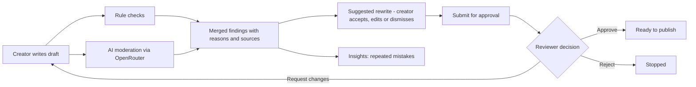

# 🛡️ BrandGuard

**AI-assisted brand governance and content moderation: check content *before* it is published, understand *why* it was flagged, and let a human make the final call.**

Built by **Team Binary Brains** (Krish Kumar, solo) for the **We Code Coders** hackathon, based on the **Inkloom AI** problem statement.

- 🌐 Live app: https://brandguard-6xhxmmq8zmnb8cdzmjxmej.streamlit.app/
- 💻 Code: https://github.com/krish028kumar/BrandGuard

---

## 1. The problem

Organisations publish content through many employees, agencies and AI tools. Wrong claims, outdated prices, inconsistent tone, the wrong brand spelling, inaccessible visuals and even abusive or threatening text can reach the public before anyone notices. A plain "reject" filter does not help: creators need to know **what is wrong, why, and how to fix it**, and organisations need humans to stay in control.

## 2. What BrandGuard does

1. A company's **approved rulebook** (tone, terminology, approved facts and claims, accessibility rules) is the source of truth.
2. A creator pastes a draft and clicks **Run review**.
3. BrandGuard runs two layers of checks:
   - **Rule checks (fast, always on):** terminology and brand name, tone and pressure wording, facts vs approved facts, unsupported claims, accessibility (alt text, link text).
   - **AI moderation (OpenRouter):** reads the *meaning* of the whole draft in **English, Hindi and Hinglish** and flags abuse, threats, harassment, hate, scams, illegal content and other unsafe or off-brand text, including cases no keyword list would catch.
4. Every finding shows the **exact phrase, the reason, the rule or source, a severity and a confidence level**.
5. BrandGuard suggests a rewrite as a before/after diff. **Nothing is applied automatically**: the creator can accept, edit or dismiss each fix.
6. The creator submits the draft to the **approval queue**, where a reviewer approves, requests changes or rejects, with comments and full revision history.
7. The **Insights** tab shows repeated mistakes and rules people keep dismissing, which can point to unclear guidelines.

## 3. How the workflow runs



## 4. Safety principle: a failed AI check is never "Safe"

If the AI request fails, times out, returns nothing, or returns something the app cannot understand, BrandGuard shows **UNVERIFIED**, not a clean result. The AI client retries once, can fall back to another model, and handles the different response shapes OpenRouter models return. AI findings are always labelled **"AI-assisted: a human must confirm"**, so the AI suggests and a person decides.

## 5. Tech stack

| Layer | Choice | Why |
|---|---|---|
| Language | Python | Fast to build, strong text tooling |
| UI | Streamlit + custom CSS | Working interface quickly, with a custom look |
| AI | OpenRouter API (urllib, no extra SDK) | One API to many models, multilingual understanding |
| Rules | Python + `rulebook.json` | Deterministic, explainable, editable by non-developers |
| Data | pandas, local JSON store | Simple storage for reviews, comments and insights |
| Hosting | GitHub + Streamlit Community Cloud | Free and quick to deploy |

## 6. Project structure

| File | What it does |
|---|---|
| `app.py` | The Streamlit app: tabs for review, approval queue, insights and rulebook; roles and workflow |
| `engine.py` | Rule-based review engine, suggested fixes, diff view, merging of findings |
| `ai_check.py` | OpenRouter integration: prompt, response handling, retries, fail-closed behaviour |
| `ui.py` | Styling and HTML components (score ring, highlighted draft, finding cards) |
| `rulebook.json` | The sample brand rulebook (BrightCart): tone, terminology, facts, claims, safety words |
| `requirements.txt` | Python dependencies |

## 7. Roles and approval flow

| Role | What they can do |
|---|---|
| Creator | Write drafts, run reviews, submit for approval |
| Reviewer / Manager / Admin | Approve, request changes or reject, with comments |

Every submission keeps a version history with before/after changes, comments and decisions.

## 8. How to try it

Open the live app, then:
1. In the sidebar, click **Demo data** to load sample reviews (clearly marked "demo").
2. On **Review content**, load a sample or write your own text and click **Run review**.
3. Look at the score, the highlighted draft, and each finding's reason and source.
4. Click **Submit for approval**, switch the role to **Reviewer**, and decide in the **Approval queue**.
5. Open **Insights** to see repeated mistakes.

| Try this text | What to expect |
|---|---|
| `Our new Plus plan is just Rs 399 per month.` | Flags a price that does not match the approved fact (Rs 299) |
| `BrightKart is the BEST store!!! Click here, hurry!` | Brand name, unproven claim, tone and accessibility findings |
| `saale maar khaye gaa bhosdike` | AI flags abusive Hinglish language as a safety issue |
| `Free shipping on orders above Rs 499. Easy 7-day returns.` | Clean |

## 9. Run it yourself

```
pip install -r requirements.txt
streamlit run app.py
```

Add your key to `.streamlit/secrets.toml` (never commit this file):

```
OPENROUTER_API_KEY = "your-key"
MODEL = "your-model-name"   # optional
```

## 10. How we built it

1. **Planned** the problem, users, workflow and stack (Round 1 plan).
2. Built the **rule engine** first: terminology, tone, claims, facts, accessibility, with a cited source for every finding.
3. Built the **review and approval workflow** with roles, comments and version history.
4. Designed the **interface**: score ring, highlighted text, finding cards, insights charts.
5. Added **AI moderation** for multilingual and context-aware safety checks, first through Claude, then moved to OpenRouter.
6. Fixed the OpenRouter integration so unusual model responses are handled and **failures show as UNVERIFIED, never Safe**.
7. Deployed through GitHub and Streamlit Community Cloud, and tested with clean, wrong-price, off-brand, English abuse and Hinglish abuse examples.

## 11. Known limitations

- AI moderation can miss things or over-flag, and free models vary in quality and speed. That is why every AI finding needs human confirmation.
- Roles are chosen from a dropdown. There is no real login or per-user permission system yet.
- Review data is stored in a simple local file, so it can reset when the free host restarts.
- Only text is reviewed so far; image and document review are not built yet.
- The brand rulebook is a sample brand invented for the demo.

## 12. Roadmap

- 🖼️ Image review: logo, colour palette, contrast, alt text
- 📄 Document import (PDF and DOCX)
- 🔐 Real login and role-based permissions
- 📊 Deeper governance insights per team and channel
- 🔌 Integrations with publishing tools (for example Slack, LinkedIn, WordPress)

## 13. Disclosure

- **External service:** OpenRouter, which routes requests to third-party AI models. Draft text is sent there only when the AI check runs, so do not paste confidential material into the demo.
- **Libraries:** Streamlit and pandas (open source).
- **AI assistance:** this project was built with help from AI assistants (Claude and ChatGPT) and reviewed and deployed by the author.
- The sample brand "BrightCart" and all sample posts are invented for the demo.

## 14. Team

**Binary Brains**: Krish Kumar, B.Tech Information Science and Engineering, Dayananda Sagar College, Bengaluru. Solo participant, responsible for product, backend, AI integration, frontend, testing and documentation.
